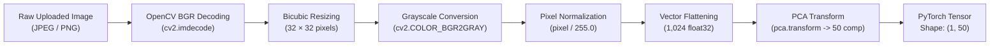

# TrafficSign AI — Comprehensive System Documentation & Technical Guide
**University Machine Learning Final Project: Cambodian Traffic Sign Recognition**

---

## Executive Summary

**TrafficSign AI** is an academic machine learning web application engineered to classify Cambodian road traffic signs using a hybrid pipeline of **unsupervised dimensionality reduction** (Principal Component Analysis — PCA) and **supervised deep learning** (Artificial Neural Networks — ANN / Multilayer Perceptron).

The web platform is designed as a modern, minimalist AI software-as-a-service (SaaS) application inspired by high-end design systems (clean white backgrounds, deep charcoal typography `#111827`, lime green primary accents `#22C55E`, 9999px pill controls, and rounded bento cards). It bridges offline laboratory machine learning research with an interactive, production-ready web application for real-time inference, educational visualization, and model introspection.

```
+---------------------------------------------------------------------------------------------------+
|                                  TrafficSign AI End-to-End Flow                                   |
+---------------------------------------------------------------------------------------------------+
|  [User Image / Road Crop]                                                                         |
|            │                                                                                      |
|            ▼                                                                                      |
|  [Pop-Up Modal Editor] ────► 1:1 Aspect Ratio Cropping, 90° Orientation Rotation, Auto-Contrast   |
|            │                                                                                      |
|            ▼                                                                                      |
|  [Preprocessing Pipeline] ──► Resize 32×32 ──► Grayscale ──► [0, 1] Normalize ──► Flatten 1,024   |
|            │                                                                                      |
|            ▼                                                                                      |
|  [Unsupervised PCA] ───────► Orthogonal Projection: 1,024 Pixels ──► 50 Principal Components      |
|            │                                                                                      |
|            ▼                                                                                      |
|  [Supervised PyTorch ANN] ──► 50 Inputs ──► Linear(100)+ReLU ──► Linear(50)+ReLU ──► Logits(10)   |
|            │                                                                                      |
|            ▼                                                                                      |
|  [Decision & UI] ──────────► Softmax Probabilities ──► Top-3 Candidates ──► 4-Stage Visualizer    |
+---------------------------------------------------------------------------------------------------+
```

---

## 1. Project Objectives & Academic Context

### 1.1 Purpose
Road traffic sign recognition is a foundational perception component for intelligent transportation systems (ITS) and advanced driver assistance systems (ADAS). In Cambodia, traffic signs follow national regulatory standards including circular prohibition signs, octagonal stop signs, and triangular warning signs.

This project investigates whether unsupervised feature reduction (PCA) can improve classification accuracy, reduce parameter count, and mitigate overfitting when paired with an Artificial Neural Network, compared against training neural networks directly on raw, high-dimensional pixel inputs.

### 1.2 Core Research Hypotheses
1. **Spatial Collinearity Elimination**: Adjacent pixels in a $32 \times 32$ image share massive mutual redundancy. PCA decouples these correlated spatial dependencies into orthogonal eigenvectors without needing labeled data.
2. **First-Layer Parameter Compression**: Passing 1,024 raw pixels into a 100-neuron hidden layer requires $1,024 \times 100 = 102,400$ weight parameters. By reducing the input space from 1,024 to 50 principal components (a **95.12% dimension reduction**), the first layer requires only $50 \times 100 = 5,000$ weights—saving **97,400 weights** and drastically reducing the risk of empirical overfitting on limited dataset sizes.
3. **Generalization Superiority**: Combining unsupervised PCA preprocessing with supervised backpropagation achieves higher out-of-sample generalization ($96.63\%$ test accuracy) than baseline networks trained directly on raw pixels ($92.25\% - 93.77\%$).

---

## 2. Technology Stack & Architectural Decisions

| Layer | Technology | Version | Purpose |
| :--- | :--- | :--- | :--- |
| **Frontend & Serving** | Streamlit | `1.67.0` | Reactive Python web framework for ML dashboards and reactive UI components |
| **Deep Learning Engine** | PyTorch | `2.15.0` | CPU-optimized neural network inference via `torch.inference_mode()` |
| **Dimensionality Reduction** | Scikit-Learn | `1.9.1` | Unsupervised `PCA(n_components=50)` feature transformation |
| **Computer Vision** | OpenCV (`cv2`) | `5.0.0` | High-performance array-level image decoding, resizing, and color conversions |
| **Image Manipulation** | Pillow (`PIL`) | `13.0.0` | Interactive canvas display, orientation rotations, and auto-contrast |
| **Interactive Cropper** | Streamlit-Cropper | `0.3.1` | React/Fabric.js canvas component for user-guided sign isolation |
| **Data Structures** | NumPy & Pandas | `2.5.4` / `3.1.1` | Vectorized matrix transformations and tabular benchmarking displays |
| **Model Serialization** | Joblib | `1.6.0` | Thread-safe deserialization of trained PCA transformers |
| **Testing & QA** | Pytest & Playwright | `9.2.0` / `1.65.2` | Automated unit tests and headless browser end-to-end visual verification |

---

## 3. Project Directory Structure

```
WebML/
├── app.py                          # Main Streamlit web application & UI orchestrator
├── DOCUMENTATION.md                # Comprehensive technical documentation & user guide
├── README.md                       # Project overview, installation steps, and test guide
├── requirements.txt                # Pinned Python package dependencies
├── .gitignore                      # Git exclusion rules for virtual environments and caches
├── .streamlit/
│   └── config.toml                 # Streamlit server and light theme enforcement settings
├── models/
│   ├── best_ann.pth                # Pretrained PyTorch weights (state dictionary)
│   └── pca_ann.pkl                 # Pretrained Scikit-Learn PCA transformer (joblib format)
├── config/
│   └── class_names.json            # Ground-truth class catalog, descriptions, and IDs
├── src/
│   ├── __init__.py                 # Python package initializer
│   ├── model.py                    # PyTorch TrafficSignANN class & model/PCA loader functions
│   ├── preprocessing.py            # 8-stage image preprocessing pipeline & visualizer tensors
│   └── prediction.py               # End-to-end inference logic, top-k ranking, & latency profiling
├── assets/
│   ├── styles.css                  # Custom Kiwi AI SaaS CSS theme & fixed navbar layout
│   ├── hero_illustration.svg       # Custom vector SVG graphic for the hero workstation
│   └── sample_images/              # 10 official regulatory icons & 10 ground-truth test crops
└── tests/
    ├── conftest.py                 # Pytest configuration and sys.path resolution
    ├── test_preprocessing.py       # Unit tests verifying shapes, grayscale, and normalization
    └── test_prediction.py          # Unit tests verifying inference, top-k ordering, and CPU execution
```

---

## 4. Machine Learning Model Architecture & Preprocessing Pipeline

### 4.1 Supported Traffic Sign Classes
The deployed model classifies **10 selected Cambodian traffic sign categories**:

| Internal Class Index | Original Dataset ID | Sign Name | Category | Description |
| :---: | :---: | :--- | :--- | :--- |
| **0** | `0` | Pedestrian Crossing | Regulatory | Blue square with white walking person silhouette |
| **1** | `1` | No Left Turn | Regulatory | Red prohibition circle with crossed left arrow |
| **2** | `2` | No Right Turn | Regulatory | Red prohibition circle with crossed right arrow |
| **3** | `4` | No Entry | Regulatory | Red solid circle with horizontal white bar |
| **4** | `5` | Speed Limit 20 | Regulatory | Red circle with black numeral "20" on white background |
| **5** | `7` | No Parking | Regulatory | Red circle with blue background and single red diagonal slash |
| **6** | `8` | No Stopping | Regulatory | Red circle with blue background and crossed red X |
| **7** | `9` | No Overtaking | Regulatory | Red circle with two cars (one red, one black) |
| **8** | `22` | Stop | Regulatory | Red octagonal sign with white Khmer/English script |
| **9** | `33` | Children Crossing | Warning | Yellow diamond with silhouette of children running |

### 4.2 Preprocessing Pipeline (`src/preprocessing.py`)
To ensure zero training-serving skew, inference preprocessing strictly reproduces the training pipeline:



1. **Decoding**: Uploaded image bytes are decoded via `cv2.imdecode()` into standard BGR color format.
2. **Resizing**: Resized to exactly $32 \times 32$ pixels using bicubic/area interpolation.
3. **Grayscale Conversion**: Converted to single-channel intensity using standard luminosity weights:
   $$Y = 0.299R + 0.587G + 0.114B$$
4. **Range Normalization**: Pixel integers $[0, 255]$ are divided by $255.0$ to produce floating-point values in $[0.0, 1.0]$.
5. **Flattening**: The $32 \times 32$ matrix is unrolled into a 1D vector of length $1,024$.
6. **PCA Projection**: Projected via pre-fitted eigenvectors:
   $$\mathbf{z} = (\mathbf{x} - \boldsymbol{\mu}) \mathbf{W}_{50}$$
   where $\boldsymbol{\mu} \in \mathbb{R}^{1024}$ is the feature mean and $\mathbf{W}_{50} \in \mathbb{R}^{1024 \times 50}$ contains the top 50 orthogonal eigenvectors.
7. **Tensor Packaging**: Transformed into a PyTorch `torch.FloatTensor` with shape `(1, 50)`.

### 4.3 Neural Network Architecture (`src/model.py`)
The ANN is implemented using PyTorch `nn.Sequential` with layer naming that precisely matches the checkpoint state dictionary:

```
Input Vector (50 PCA components)
     │
     ▼
[Layer 0] Linear(in_features=50, out_features=100, bias=True)   ──► 5,100 parameters
     │
     ▼
[Layer 1] ReLU() Activation Function: f(x) = max(0, x)
     │
     ▼
[Layer 2] Linear(in_features=100, out_features=50, bias=True)   ──► 5,050 parameters
     │
     ▼
[Layer 3] ReLU() Activation Function: f(x) = max(0, x)
     │
     ▼
[Layer 4] Linear(in_features=50, out_features=10, bias=True)    ──► 510 parameters
     │
     ▼
Raw Unnormalized Logits (10 classes)
     │
     ▼
Softmax Function: P(y = c | z) = exp(z_c) / Σ exp(z_j)
```

**Total Learnable Parameters**: $5,100 + 5,050 + 510 = 10,660$ parameters.

### 4.4 Inference Protocol (`src/prediction.py`)
- Executed under `torch.inference_mode()` to eliminate gradient computation overhead and save memory.
- Evaluated on CPU with thread locks for cross-platform stability.
- Softmax converts raw logits into a probability distribution over the 10 classes.
- Argmax selects the top class; top-3 candidates are extracted using `torch.topk(probabilities, k=3)`.
- Wall-clock inference latency is measured using microsecond-precision timers (`time.perf_counter()`).

---

## 5. Experimental Benchmarks & Evaluation

Offline experiments conducted on the original dataset of **7,498 cropped traffic signs** (split into 5,248 training, 1,123 validation, and 1,127 held-out test crops) produced the following comparative results:

| Model Architecture | Input Dimensions | First-Layer Weights | Validation Accuracy | Final Test Accuracy | Status |
| :--- | :---: | :---: | :---: | :---: | :--- |
| **ANN Model A (Raw Pixels)** | 1,024 | 102,400 | 93.77% | — | Baseline |
| **ANN Model B (Raw Pixels)** | 1,024 | 102,400 | 92.25% | — | Baseline |
| **PCA + ANN (Final Champion)** | **50** | **5,000** | **96.44%** | **96.63%** | **Deployed Model** |

**Key Takeaways**:
- The PCA + ANN architecture achieved **96.63% accuracy** on unseen test data (1,089 correct out of 1,127 test crops).
- Reducing dimensions from 1,024 to 50 eliminated $95.12\%$ of the input features while **increasing test accuracy by +2.86%** over raw pixel baselines.

---

## 6. User Interface & Feature Walkthrough

### 6.1 Fixed Floating Navbar
- Designed as a floating translucent pill (`backdrop-filter: blur(20px)`, `border-radius: 9999px`).
- Configured with `position: fixed !important; top: 1rem;` so it remains pinned at the top of the viewport when scrolling.
- Automatically fades out when a modal pop-up is open to prevent visual clutter.
- All section targets use `scroll-margin-top: 100px` so clicking navigation links (**Home**, **Classifier**, **Architecture**, **Benchmark**, **Classes**) lands with comfortable breathing room below the navbar.

### 6.2 Instant Sign Classification (Bento Row 1)
- **Drag-and-Drop Uploader**: Accepts JPG, JPEG, and PNG images up to 200MB.
- **File Fingerprinting**: Uses `file_id = f"{name}_{size}"` so applying crops or editing images never causes Streamlit to overwrite your cropped image on subsequent script reruns.
- **Action Pills**:
  - `🚀 Predict Sign`: Immediately passes the image through the PCA + ANN pipeline.
  - `✂️ Edit / Crop`: Launches the compact pop-up modal editor.
  - `🔄 Clear`: Resets the workspace.

### 6.3 Pop-Up Modal Image Editor (`@st.dialog`)
- **Compact Dimensions**: Constrained to `max-width: 620px` and `max-height: 88vh`, fitting completely within the browser window without vertical page scrolling.
- **Orientation Rotation**: Single-click rotation through `0°`, `90° ↻`, `180°`, and `270° ↺` to fix smartphone photos taken in portrait or sideways orientation.
- **Auto-Contrast Enhancement**: Pillow auto-contrast toggle to brighten shadows and enhance sign edges in backlit or dim photos.
- **Aspect Ratio Control**: Toggle between `1:1 Square (Sign Focus)` (recommended for the $32 \times 32$ input layer) and `Freeform`.
- **Full-Resolution Coordinate Mapping**: Scales the display so 100% of the photograph is visible without clipping, then maps the green bounding box coordinates back to the original uncompressed image bytes.
- **Dual Live Previews**: Displays both the cropped color sign and an educational simulation of the **32×32 Grayscale Model View**.
- **Action Buttons**: `✅ Apply Crop` (updates the dashboard), `🚀 Apply & Predict` (crops and predicts in one click), and `Cancel`.

### 6.4 Dataset Benchmark Quick-Picker
- 10 interactive grid buttons featuring verified test crops from the held-out evaluation set (`Pedestrian`, `No Left`, `No Right`, `No Entry`, `Speed 20`, `No Parking`, `No Stop`, `No Pass`, `Stop`, `Children`).
- Clicking any sample immediately loads it, runs inference, and displays predictions.

### 6.5 Real-Time Prediction Results Display
When a prediction is generated, the application surfaces:
1. **Primary Prediction Badge**: Highlighted sign name, original dataset ID, and internal model index.
2. **Softmax Score**: Prediction confidence percentage.
3. **Inference Latency**: Precise CPU execution time (typically $1.5 - 3.5$ ms).
4. **Top-3 Candidates**: Ranked probability distribution with custom horizontal progress bars.
5. **Educational Disclaimer**: Reminding users that Softmax scores represent relative uncalibrated logit distances and should not be used for safety-critical autonomous driving decisions.

### 6.6 4-Stage Image Preprocessing Visualizer
An interactive breakdown displaying the mathematical transformation of the image:
1. **Input Crop**: The original color image.
2. **Resized 32×32**: Spatial normalization preserving geometric aspect.
3. **Grayscale Matrix**: Elimination of chromatic lighting noise.
4. **Normalized Heatmap**: Floating-point values $[0.0, 1.0]$ visualized with a viridis intensity colormap.

### 6.7 "How the Model Works Inside" Glass-Box Introspection Engine
A dedicated educational section allowing students, instructors, and evaluators to look directly inside the trained network:
1. **Live Layer Activations (Image X-Ray)**:
   - **50-PCA Principal Component Spectrum**: Interactive bar chart displaying the 50 eigenvector projection values ($\mathbf{z}_1 \dots \mathbf{z}_{50}$).
   - **Hidden Layer 1 (100 Neurons)**: Bar chart of post-ReLU activations highlighting selective neuron firing and biological inhibition (typically $\sim 40\% - 55\%$ sparsity where inactive neurons are zeroed out).
   - **Hidden Layer 2 (50 Neurons)**: Bar chart displaying high-level semantic traffic sign archetype detectors.
   - **Output Logits $\rightarrow$ Softmax Probabilities**: Comprehensive comparison table showing unbounded real logits ($z_i \in (-\infty, +\infty)$) and exponentiated Softmax posterior probabilities summing to 1.0.
   - **Dual Inspection Mode**: Seamlessly alternates between **Baseline Demonstration** (using sample test signs) and **Live Active Inspection** (reflecting live predictions in real-time).
2. **4-Stage Mathematical Pipeline**:
   - Four structured mathematical cards detailing Spatial Discretization ($32 \times 32 \rightarrow 1,024$), Unsupervised PCA Projection ($\mathbf{z} = (\mathbf{x} - \boldsymbol{\mu})\mathbf{W}_{50}$), Deep Feedforward Propagation ($\mathbf{h} = \text{ReLU}(\mathbf{W}\mathbf{x} + \mathbf{b})$), and Softmax MAP Classification.
3. **Interactive Network Topology Diagram**:
   - A clean SVG computational graph displaying tensor shapes, synapse connections, and parameter calculations ($5,100 + 5,050 + 510 = 10,660$ total learnable parameters).
   - Parameter matrix table detailing weights, biases, and activation functions per layer.

---

## 7. Important Operational Constraints & Limitations

> [!WARNING]
> **Classification vs. Object Detection**: The model is a **sign classifier**, NOT an object detector (like YOLO or Faster R-CNN). It was trained exclusively on tightly cropped bounding boxes of signs. Uploading a wide-angle photograph of an entire street without cropping the sign first will result in poor accuracy because background clutter will dominate the PCA components. Always use the **✂️ Edit / Crop** tool to isolate the sign.

> [!NOTE]
> **Closed-World Assumption**: The model operates under a closed-set assumption with 10 classes. An unsupported sign (e.g., Speed Limit 50 or Roundabout) will still be classified as one of the 10 known categories. Low Softmax probabilities cannot be reliably interpreted as an unknown-sign detector.

> [!IMPORTANT]
> **Educational Research Scope**: This web application is built strictly for academic presentation and machine learning research. It must never be used for live driving, autonomous vehicle navigation, or safety-critical decisions.

---

## 8. Installation, Execution & Testing Guide

### 8.1 Prerequisites
- Python 3.10, 3.11, 3.12, or 3.13
- macOS, Linux, or Windows 10/11

### 8.2 Installation
```bash
# 1. Clone or navigate to the project directory
cd WebML

# 2. Create and activate a Python virtual environment
python3 -m venv .venv
source .venv/bin/activate       # macOS / Linux
# or .venv\Scripts\activate     # Windows

# 3. Upgrade pip and install dependencies
pip install --upgrade pip
pip install -r requirements.txt
```

### 8.3 Running the Application
```bash
# Launch Streamlit in light mode
streamlit run app.py --theme.base="light"
```
The application will open automatically at `http://localhost:8501`.

### 8.4 Running the Automated Test Suite
The project includes a comprehensive test suite in `tests/`:
```bash
# Run all unit tests
pytest tests -v
```
All 14 tests will execute, validating:
- Model and PCA weight loading
- 8-stage image preprocessing output tensor shape `(1, 50)` and `float32` dtype
- Softmax probability normalization ($\sum p_i = 1.0$)
- Top-k candidate ordering
- End-to-end inference on real dataset samples
- Graceful handling of invalid and corrupt image inputs
